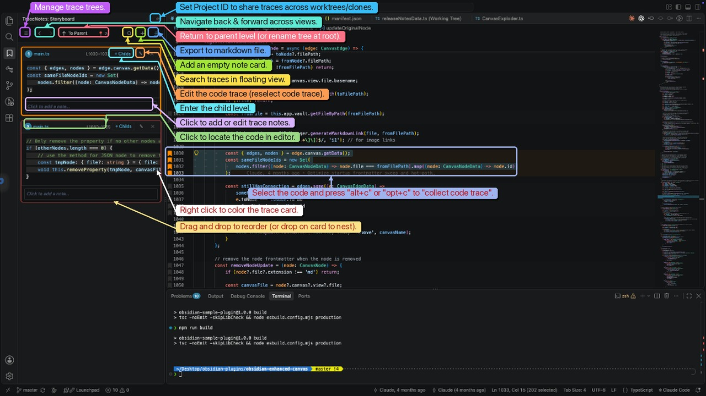

# TraceNotes

> An extension for code tracing and note-taking that supports exporting and importing in Markdown format.

### Select code and press **`Opt+C`** or **`Alt+C`** to collect a trace. See [Features](#features) for the rest.

TraceNotes is an extension for navigating and documenting code logic. It allows you to build a structured narrative of code flows that stay synchronized with the editor.

## Features

### Collection & Recovery

- **Capture** – Select code and press `Opt+C` (`Alt+C`), or click `+` for a standalone note card. Snippets are dedented automatically.
- **Recovery** – Traces re-anchor after edits via exact, whitespace-normalized, then fuzzy matching, falling back to a workspace-wide search for moved code. Unrecoverable traces are marked `Orphaned`; re-bind them with **`✎`**.
- **Undo Remove** – `Cmd+Z` (`Ctrl+Z`) in the Storyboard restores deleted cards and their children.

### Organization & Navigation

- **Hierarchy** – Nest traces up to 10 levels and keep multiple trace trees in **`Manage Traces`**.
- **Drag and Drop** – Reorder cards, drop on **`Move to Child`** to nest, or on **`To Parent`** to move up a level.
- **Canvas (`🔍`)** – View the whole tree on a 2D canvas. Drag to pan, `Ctrl/Cmd + Scroll` to zoom, click to jump.
- **Search** – Search the current tree or all trees with `AND`, `OR`, `NOT` / `-term`, `"phrases"`, and `( )`.
- **History** – Go back and forward (`<` / `>`) through visited cards, groups, and trees.

### Notes & Editor Sync

- **Markdown Notes** – GFM rendering with links and clickable task checkboxes.
- **Note Editing** – List continuation, `Tab` / `Shift+Tab` indent, selection wrapping (`*`, `` ` ``, `_`, `~`, brackets, quotes).
- **Editor Sync** – Clicking a card jumps to its code; moving the cursor highlights the matching card.
- **Colors & Gutter** – Right-click a card to pick one of 8 colors. Gutter markers show traces outside the current group; hover to preview the note and **`↗ Jump to card`**.

### Project Sharing (Worktrees & Clones)

- **Cross-Checkout Sync** – Worktrees and clones of one repo share traces, matched by git `origin`, folder name, or **`Set Project ID`** (`🔗`).
- **Per-Checkout Positions** – Paths are workspace-relative and positions are tracked per checkout, so branches don't conflict. Edits sync live across windows.

### Import & Export

- **Markdown** – Lossless round-trip: headings for hierarchy, `%%Tag%%` for colors (Obsidian-compatible), and `<!-- tracenote -->` fences around notes.
- **JSON** – Back up all trees to `tracenotes-data.json`. **`Import Trace`** accepts `.md` and `.json`.

### AI Agents (Skill & CLI)

Let Claude Code, Codex, or Cursor build and edit trace trees for you — e.g. *"trace the login flow into TraceNotes"*.

- **CLI** – The extension installs `~/.tracenotes/bin/tracenotes` (`tracenotes.cmd` on Windows). Run it from inside a project folder that is open in VS Code; it talks to that window, and changes show up live in the panel. Output is JSON. Run `~/.tracenotes/bin/tracenotes help` for the full guide.
- **Skill** – On first start, if `~/.claude`, `~/.codex`, or `~/.cursor` exists, TraceNotes offers to write a `tracenotes` skill to `<dir>/skills/tracenotes/SKILL.md` so the agent knows how to use the CLI. Installed skills are refreshed on every start to match the extension version.
- **Installed an agent later?** Open it once (so its config folder exists), then run **`TraceNotes: Set Up AI Agents`**. With no agent config found, just tell your agent to run `~/.tracenotes/bin/tracenotes help`.

| CLI command | What it does |
| :-- | :-- |
| `list` / `show [--outline]` | List trees / print a tree with trace ids |
| `create --name <name>` | Create a tree from Markdown on stdin |
| `add [--parent \| --after \| --before <id>]` | Add traces from Markdown on stdin |
| `note <id>` / `rm <id>…` | Replace a note / remove traces |
| `check` / `refresh <id>…` | Find traces whose code changed / re-read their code |
| `rename` / `delete-tree` | Rename or delete a tree |

Input uses the same Markdown format as **Export to Markdown**; a code fence's info line is `<lang> <start>:<end>:<path>` (or `?:?` with the code pasted in, to let TraceNotes find it).

---

## Commands & Shortcuts

| Action                     | Shortcut (macOS)      | Shortcut (Win/Linux)   | Context / Command                     |
| :------------------------- | :-------------------- | :--------------------- | :------------------------------------ |
| **Collect Trace**          | `Option + C`          | `Alt + C`              | `TraceNotes: Collect Trace`           |
| **Undo Remove**            | `Cmd + Z`             | `Ctrl + Z`             | Storyboard focus                      |
| **Save / Cancel Note**     | `Cmd + Enter` / `Esc` | `Ctrl + Enter` / `Esc` | Note editor focus                     |
| **Toggle Bold**            | `Cmd + B`             | `Ctrl + B`             | Note editor focus                     |
| **Export MD**              | —                     | —                      | `TraceNotes: Export to Markdown`      |
| **Import MD / JSON**       | —                     | —                      | `TraceNotes: Import Trace`            |
| **Export All Data (JSON)** | —                     | —                      | `TraceNotes: Export All Data to JSON` |
| **Clear Current Tree**     | —                     | —                      | `TraceNotes: Clear All Traces`        |
| **Set Project ID**         | —                     | —                      | `TraceNotes: Set Project ID`          |
| **Set Up AI Agents**       | —                     | —                      | `TraceNotes: Set Up AI Agents`        |

---

## Support

If you find this extension helpful, consider buying me a coffee!

---

## License

Distributed under the **MIT License**.
